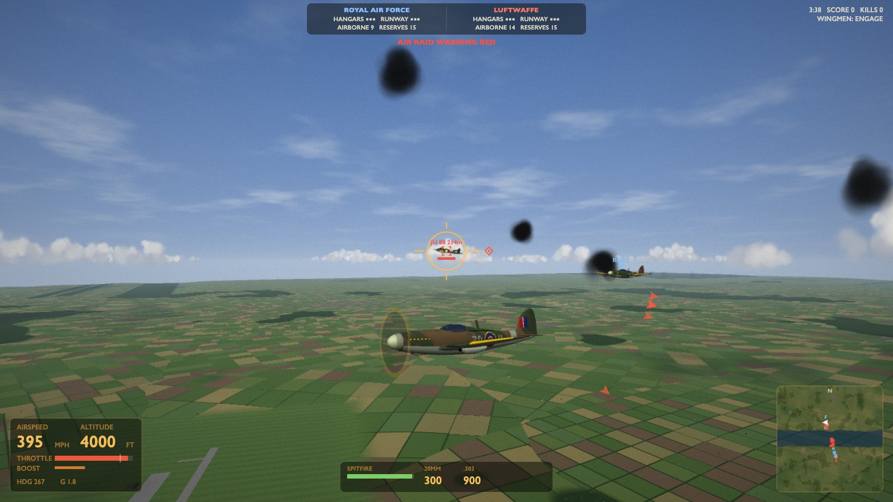
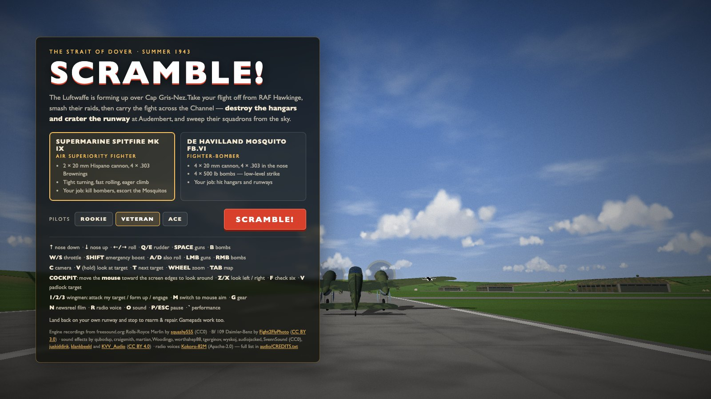
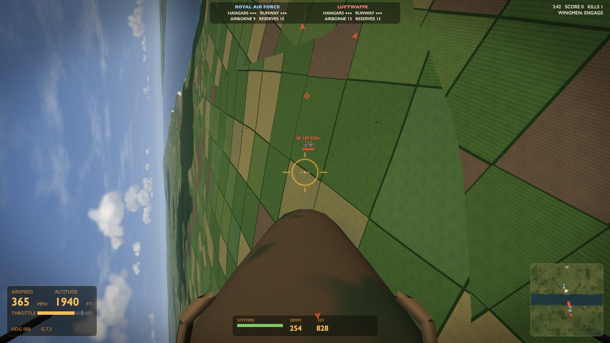
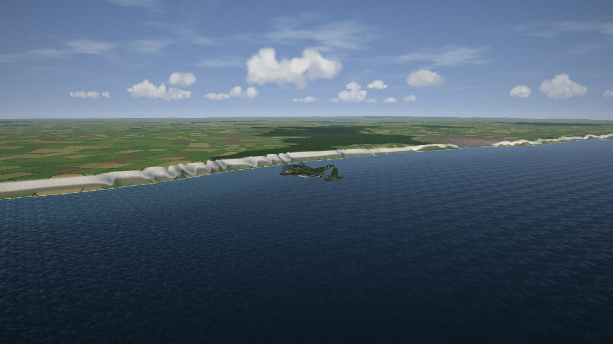
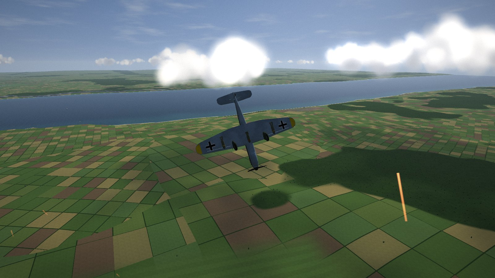
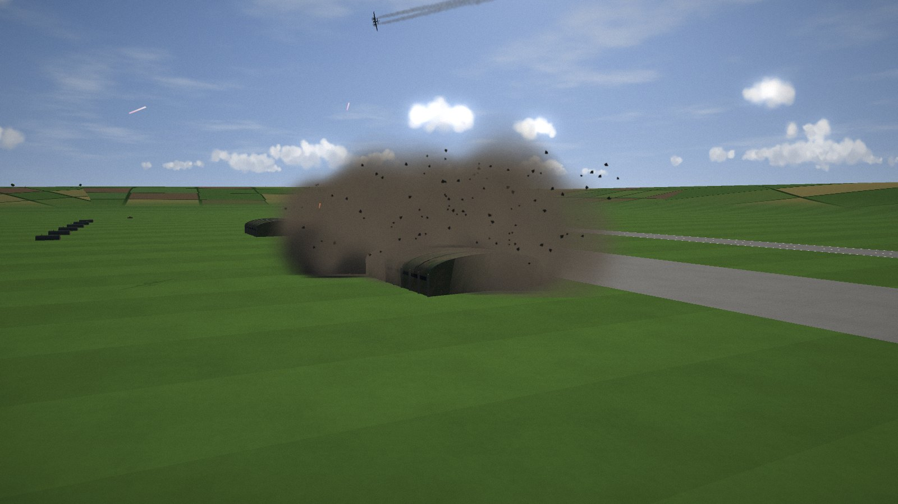
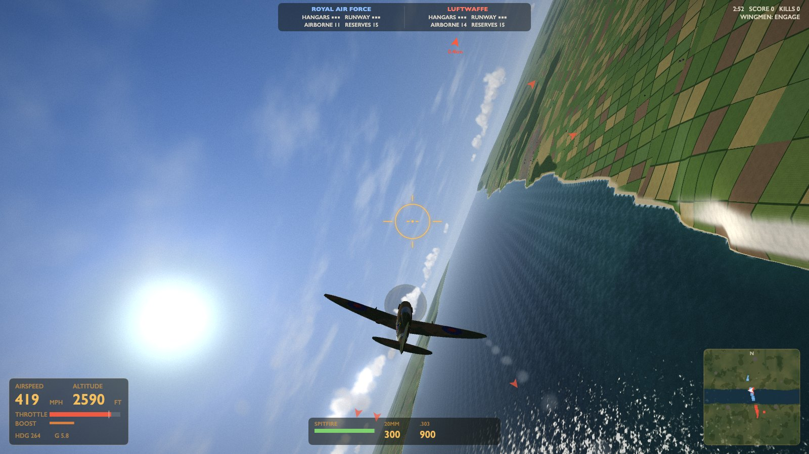
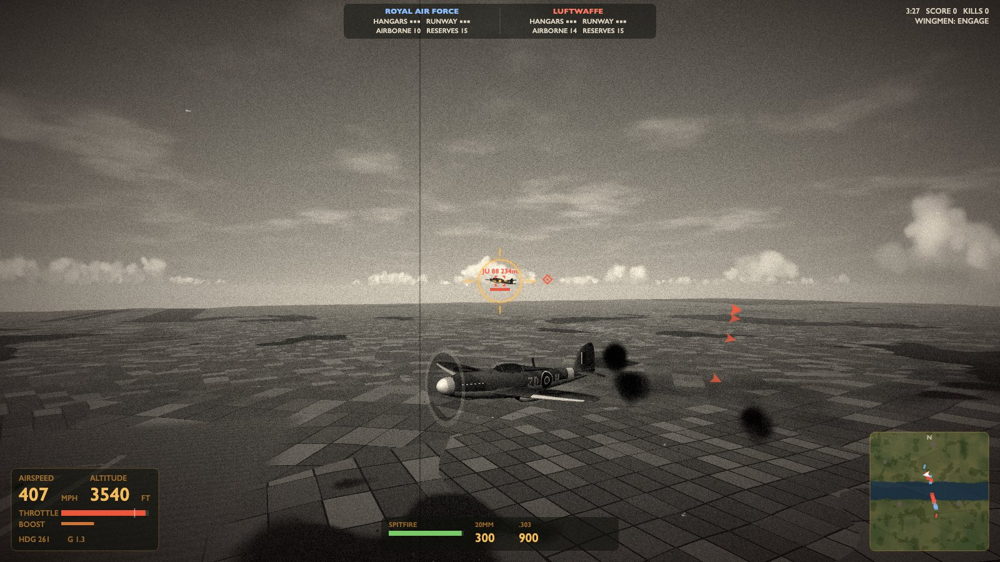

# SCRAMBLE! — Channel 1943

A WW2 arcade air-combat game in the browser: Spitfires and Mosquitos against Bf 109s, Fw 190s,
Ju 87 Stukas and Ju 88s over a compressed Strait of Dover. Two airfields, a 44 km battle area, and two AI
commanders who scramble fighters, send bomber raids with escorts and fight a war of attrition.
You decide it.

No build step, no dependencies: plain ES modules, raw WebGL2 and Web Audio. Every model and texture and
almost every sound is generated at start-up; the engines are real recordings (see Credits).



| | |
| --- | --- |
|  |  |
| Title screen, with the battle already running behind it | Cockpit: diving on a Bf 109, lead marker ahead of the reflector sight |
|  |  |
| A Ju 88 raid crossing the Channel below the White Cliffs | A Stuka rolls into its dive, 40 mm tracer coming up to meet it |
|  |  |
| Low-level Mosquito strike: a 500 lb bomb bursts on a hangar | Pulling hard over the chalk cliffs, wingtip vapour streaming |


*Press **N** for the newsreel film look.*

## Run

```sh
cd www2-dogfigher
python3 -m http.server 8000      # or: npx serve .
# open http://localhost:8000  (Chrome, Edge, Firefox or Safari)
```

Pick the **Spitfire** (cannon, air superiority) or the **Mosquito** (cannon + 4 × 500 lb bombs), a pilot
level, and press **SCRAMBLE!** You start on the runway at RAF Hawkinge with three wingmen; the Luftwaffe's
first raid is already forming over Cap Gris-Nez.

**Win:** destroy the three hangars at Audembert (they hold the enemy reserves), crater all three runway
sections (no more take-offs) and shoot down whatever is left in the air. **Lose:** the same happens to
Hawkinge. Shot down? Pick another aircraft from your reserves while your runway still works.

Choose **WIRELESS FACTORY RAID → START RAID** to fly the **Bristol Beaufighter** yourself.
Take off from RAF Hawkinge, lead three AI wingmen across the Channel and Dutch countryside, and bomb a
large radio and valve works with fifteen sawtooth-roof factory halls. Use the normal flight controls:
pull back above 100 mph to take off, press **G** to raise the gear, and follow the waypoint markers,
heading and suggested altitude. The map shows the route and factory.

Line up the yellow bomb impact circle with the factory and press **B / RMB** to release your two bombs.
The eight-second fuze starts on impact. **Win by hitting the factory with your own bombs and escaping
back to the sea at the Dutch coast.** Follow the escape waypoints west, then north. A finite pair of
Bf 109 interceptors arrives after the attack; stay low, manoeuvre, use your cannon, or call **2** for
wingman fighter cover. The fighters can be drawn off by your escorts, and disengage when you escape.
Missed bombs or losing your aircraft before reaching the coast ends the raid in failure.

**PRACTISE FROM DUTCH COAST** on the title screen starts you airborne just inland of the Dutch coast,
at about 290 mph and 210 ft above the ground, with gear up and three wingmen in formation. Use
**RETRY FROM DUTCH COAST** in the pause or result menu to repeat the approach immediately. Each retry
restores aircraft, weapons, factory buildings and all eight AA guns, and clears scores, damage and alarms.
Your pilot difficulty and flight controls carry over. **Enter** or controller **Options / Menu** on the
raid result screen selects the coast retry; **FULL SORTIE FROM BRITAIN** restarts on the runway.

Raid wingman orders are **1: suppress AA**, **2: cover me / form up**, and **3: bomb the factory**.
Controller D-pad left / right cycles the same orders; the HUD shows the active order. Suppression
spreads the wingmen between live gun positions for actual cannon strafing passes. The factory order
sends them on their own bombing runs. Cover breaks off those attacks and brings healthy wingmen back
into formation for your escape, engaging nearby enemy fighters. They stop pursuing damaged fighters
that retreat. Orders issued far from the target take effect when the flight closes
in. Wingmen preserve their bombs during suppression, and the player must still score a bomb hit to win.

Six light AA positions cover the approach, factory perimeter and escape route; two heavy batteries
fire time-fused flak at higher aircraft. **Climbing above about 400 ft AGL makes both AA types more
dangerous.** Threat builds up to full strength at about 1,500 ft: guns acquire you twice as quickly,
fire up to 2.8 times as often, aim more tightly, and their hits do three times the damage. Higher
aircraft are also visible at longer ranges. These changes apply to the factory batteries; the
Channel battle retains its usual tuning. Stay low to avoid heavy flak, vary your heading to spoil the light guns' aim,
or strafe the red AA markers with cannon to destroy the positions. Terrain and intact factory roofs
block their sight. The HUD reports when the defences are alerted or firing, with radio warnings,
an air-raid siren, tracer fire and nearby flak shock. Rookie pilots give you more reaction time and
less accurate enemy fire; Ace increases the danger. Replaying restores all eight guns.

The debrief awards a **mission grade** for bomb accuracy, factory damage, surviving wingmen, aircraft
condition and a successful escape. The **raid score** also rewards guns destroyed, personal air kills,
low flying and landing bonuses. Personal bests are
saved locally, separately for each difficulty and for coast practice versus a full sortie.

After reaching the sea, choose **CONTINUE HOME · LANDING BONUS** for the optional return to RAF Hawkinge.
You keep the same aircraft, ammunition and damage. Follow the English-coast and northern-approach
waypoints, then turn south, lower the gear, land on the home runway and brake to a stop. A safe landing
adds **750 points**, with **500 extra** if the aircraft is damaged. Bonuses are recorded before the ground
crew repairs the aircraft and cannot be collected twice. Losing the aircraft on this optional return
keeps the raid successful and preserves the earlier saved record, with no landing bonus. Wingmen recovered by the base count as
survivors in the final debrief.

**C** cycles chase / cockpit / raid cameras; flight controls remain active in every view. The optional
raid camera includes air-to-air shots, the bombing pass and shaky rear observer footage. In the cockpit,
hold **F** to look back. **M** switches mouse aim, **N** toggles the newsreel look, and **P / Esc** pauses.
This is an imagined Beaufighter raid with compressed geography and an arcade bomb load, inspired by
[Operation Oyster against the Philips works at Eindhoven](https://www.philips.nl/en/a-w/philips-museum/news/news/outdoor-tour-saint-nicholas-day-1942.html).

## Deploy (GitHub Pages)

`.github/workflows/pages.yml` publishes the game on every push to `master` (or run it by hand from the Actions
tab). It syntax-checks the modules, runs a short headless AI battle as a smoke test, then uploads only what
the game serves (`index.html`, `css/`, `js/`, `audio/`). One-time setup: repository **Settings → Pages →
Source: GitHub Actions**. All paths are relative, so the game works from the `https://<user>.github.io/<repo>/` subpath.

## Controls

| | |
| --- | --- |
| ↑ / ↓ | Stick forward = nose down / stick back = nose up (release to hold attitude) |
| ← / → (or A / D) | Roll · **Q / E** rudder |
| Space / LMB | Guns |
| B / RMB | Bombs (Mosquito: the yellow circle is the impact predictor) |
| W / S | Throttle · **Shift** emergency boost (watch the engine heat) |
| M | Switch to mouse-aim flying (point where you want to go; click to capture the mouse) and back |
| C | Camera: chase / cockpit / fly-by · **V** (hold) look at your target · wheel: zoom |
| Cockpit look | Move the mouse toward the screen edges to turn your head (sides = along the wings, far edge = over your shoulder, top = up); centre = straight ahead. **Z / X** look left / right, **F** check six, **V** padlock the target |
| T | Next target (the red diamond is the gun lead point) |
| 1 / 2 / 3 | Wingmen: attack my target / form up on me / engage at will |
| G | Gear and flaps, together: raise them after take-off (the HUD nags above 190 mph), lower them on final (flaps only extend below about 200 mph) · land and stop on your own airfield to rearm and repair (hold **S** to brake; closing the throttle also brakes). Closing the throttle in the air brakes too: the windmilling propeller is a big air brake. The altimeter reads height above the ground, and a landing checklist appears on approach: gear, speed, sink rate, wings level |
| Tab | Big map · **N** newsreel film look · **R** radio voices on/off · **O** sound · **P / Esc** pause · **`** performance overlay |

### Gamepad (DualShock 4 / DualSense / Xbox)

Plug in or pair the controller and press any button; the title screen then lists the bindings for it. The
browser has to expose it with the standard mapping (Chrome, Edge, Safari and Firefox all do for these pads).

| PlayStation (Xbox) | |
| --- | --- |
| Left stick | Fly: pitch and roll (release to hold attitude) |
| L1 / R1 (LB / RB) | Rudder |
| R2 (RT) | Guns |
| L2 or ✕ (LT or A) | Bombs |
| D-pad ↑ / ↓ | Throttle · **L3** (left stick click) emergency boost |
| Right stick | Look around: head look in the cockpit, orbit the chase camera · **R3** check six |
| △ (Y), hold | Look at / padlock the target |
| □ (X) | Next target |
| ○ (B) | Camera |
| D-pad ← / → | Wingman orders: step through attack my target / form up / engage at will |
| Share (View) | Gear · **Touchpad** big map · **Options (Menu)** pause |
| Menus | D-pad or left stick to move, **✕ (A)** to choose, **○ (B)** to resume, **Options** to scramble |

The controller rumbles with your guns, hits taken, nearby explosions and flak, bomb release and the stall
buffet (Chrome, Edge and Safari). Most browsers do not count a pad press as a user gesture for Web Audio, so if you start
from the controller, the sound comes on with the first click or key press.

## What's going on under the hood

* **Arcade flight model** (`js/flight.js`): the stick commands body rates and a released stick holds
  attitude, on top of a point-mass with power-limited thrust, parasite and induced drag, AoA lift with a
  stall, and side force. Corner speed, energy bleed in hard turns, zoom climbs, stalls and the Stuka's
  dive brakes all fall out of the physics. A windmilling propeller brakes hard with the throttle closed.
  Taildragger ground handling, tail-down attitude, gear-linked landing flaps (lower stall speed, lots of
  drag), ground effect, and a landed aircraft that stays on its wheels until you open up and pull for a
  go-around.
* **AI** (`js/ai.js`): every AI aircraft is flown through the same stick inputs as yours by a bank-to-turn
  controller. Behaviours: take-off, formation (velocity matching), escort, CAP, intercept, gun lead pursuit
  with skill-based aim wobble, break turns when someone is on their tail, level bombing with an impact
  predictor, Stuka dive-bombing, strafing runs, return to base. A safety layer handles terrain and stalls.
  Bomber gunners, heavy flak with time-fused bursts, and 40 mm light AA defend the airfields.
* **Commanders** (`js/sim.js`): Chain Home radar gives the RAF earlier warning; each side scrambles
  interceptors, launches raids with escorts, tops up its CAP and, later in the battle, sends fighter sweeps
  to strafe the enemy field. Aircraft come out of hangar stock, so bombing hangars and strafing parked
  aircraft reduces the enemy's reserves.
* **Renderer** (`js/render.js`): camera-relative rendering + logarithmic depth (cockpit frame at 0.3 m and
  hills at 40 km in one pass), CDLOD terrain (one grid patch instanced over a quadtree, morphing between
  levels, heights fetched in the vertex shader), a procedural English/French patchwork of fields and hedges,
  chalk cliffs, animated sea with Fresnel reflections, cloud shadows matching the sprite clouds, instanced
  everything (~40 draw calls), planar aircraft shadows, MSAA, bloom, film grading and dynamic resolution.
  Houses and trees stream in 2 km chunks with frustum culling and a far-LOD tree mesh.
* **Audio** (`js/audio.js`): real engine recordings (a Spitfire's Rolls-Royce Merlin on a static run and a
  Bf 109's Daimler-Benz run-up, cut into seamless idle / full-power loops in `audio/`) crossfaded with rpm,
  Doppler-shifted for fly-bys; synthesized engines as a fallback;
  20 mm / .303 / 13 mm guns, explosions delayed by the speed of sound, flak, the Stuka's Jericho trumpet and
  the air-raid siren.
* Simulation runs at a fixed 60 Hz; aircraft are drawn at frame time (advanced by the leftover sub-step), so
  nothing judders against the camera on 120/144 Hz displays.

## Tools

```sh
node tools/battle.mjs normal 30 4   # headless AI-vs-AI battles: outcome, losses, kill matrix, sim speed
node tools/fmtest.mjs               # flight model: top speed, climb, turn, take-off run per type
node tools/landtest.mjs             # landing: scripted idle approaches to Hawkinge must all end stopped on the wheels
node tools/raidtest.mjs             # raid, altitude-scaled AA, interception, coast retry, wingmen, physical landing and debrief
```
`tools/modelview.html` previews every procedural model; `tools/audiotest.html` plays every sound.
`node tools/make-engine-loops.mjs` rebuilds the engine loops in `audio/` from the original recordings (needs ffmpeg).
`node tools/voices/make-voices.mjs generate` produces the radio dialogue with ElevenLabs and masters it
into period-style R/T recordings (needs Node and ffmpeg; no npm dependencies). It reads the updated
`ELEVEN_LABS_API_KEY` or `ELEVENLABS_API_KEY` from the ignored root `.env`, falling back to environment
variables. Credentials remain in the offline generator and are never included in the game.

British missions use verified male British voices; the P-51/B-17 mission uses male American voices for
both mission dialogue and shared warnings/orders. Scripts and performance settings are in `js/voicelines.js`.
The short spoken dialogue uses period radio language; keyboard instructions remain in captions.

```sh
node tools/voices/make-voices.mjs plan       # review scripts and character count, no API calls
node tools/voices/make-voices.mjs voices     # inspect available male voices on the account
node tools/voices/make-voices.mjs generate   # generate or resume; completed requests are cached
node tools/voices/make-voices.mjs check      # validate all scripts, files, hashes and accent labels
node tools/voicetest.mjs                     # mission bindings, accent routing and playback cancellation
```

`--pack=british` / `--pack=american` and individual line keys restrict a generation/check. Exact requests
are cached in ignored `tools/voices/cache/`, so remastering or resuming does not bill the same requests
again. The generator verifies male/accent labels against the account's available voices. Voice overrides
can be set with `ELEVENLABS_BRITISH_VOICE_ID`, `ELEVENLABS_AMERICAN_VOICE_ID`, or per-role variants such
as `ELEVENLABS_AMERICAN_WING_VOICE_ID` in the process environment. If the system DNS stub is unavailable,
the generator resolves only `api.elevenlabs.io` through public DNS, while retaining normal HTTPS certificate
verification and leaving system network settings unchanged.

The generated `audio/voice/manifest.json` records provenance, text, voice assignments and audio hashes.
`js/voice-assets.js` maps only validated ElevenLabs clips into the game, with cache-busting audio hashes.
The browser uses prerecorded files, never live TTS or browser speech. Missing clips retain their caption
and radio squelch. Changing mission or disabling voices cancels playing and pending dialogue, preventing
a previous sortie's accent from leaking into the next. Press **R** to toggle voices.

## Credits

Radio dialogue: generated with [ElevenLabs](https://elevenlabs.io/) using `eleven_multilingual_v2`, then
band-limited, compressed and levelled for radio playback. British male voices: Daniel and George.
American male voices: Bill, Chris, Eric and Adam. Full per-line assignments are in
`audio/voice/manifest.json`; reproduction instructions are above. All previous Kokoro recordings have been replaced.

Engine recordings from [freesound.org](https://freesound.org), cut into loops by `tools/make-engine-loops.mjs`:

* ["merlin engine.wav"](https://freesound.org/people/squashy555/sounds/276597/) by squashy555, Rolls-Royce Merlin from a Spitfire on a static engine run, [CC0](https://creativecommons.org/publicdomain/zero/1.0/)
* ["Bf-109 - Daimler-Benz Run-Up"](https://freesound.org/people/Fight2FlyPhoto/sounds/142898/) by Fight2FlyPhoto, [CC BY 3.0](https://creativecommons.org/licenses/by/3.0/) (also used, pitched down, for the Fw 190)

Sound effects from [freesound.org](https://freesound.org), cut, filtered, compressed and normalised by `tools/make-sfx.mjs` into `audio/sfx/` (full list with the files each one is used for in `audio/CREDITS.txt`):

* ["Autocannon Three Shot Burst"](https://freesound.org/people/qubodup/sounds/854186/) by qubodup, [CC0](https://creativecommons.org/publicdomain/zero/1.0/): 20 mm cannon shots
* ["Air Defense Artillery Avenger Training .50cal"](https://freesound.org/people/qubodup/sounds/160355/) by qubodup, [CC0](https://creativecommons.org/publicdomain/zero/1.0/): 13 mm / .50 heavy machine-gun shots (US Army video, public domain)
* ["Clean Machine Gun Burst"](https://freesound.org/people/qubodup/sounds/482122/) by qubodup, [CC0](https://creativecommons.org/publicdomain/zero/1.0/): rifle-calibre machine-gun shots (US military video, public domain)
* ["Nearby explosion with debris.wav"](https://freesound.org/people/juskiddink/sounds/108641/) by juskiddink, [CC BY 4.0](https://creativecommons.org/licenses/by/4.0/): close explosion
* ["Explosion"](https://freesound.org/people/qubodup/sounds/182429/) by qubodup, [CC0](https://creativecommons.org/publicdomain/zero/1.0/): close explosion (US government video, public domain)
* ["mortar  grenade shell 006.wav"](https://freesound.org/people/klankbeeld/sounds/554289/) by klankbeeld, [CC BY 4.0](https://creativecommons.org/licenses/by/4.0/): close explosion, flak burst
* ["Explosion"](https://freesound.org/people/tgerginov/sounds/665092/) by tgerginov, [CC0](https://creativecommons.org/publicdomain/zero/1.0/): bomb explosion
* ["Heavy explosion in forest debris tree falling.flac"](https://freesound.org/people/wyskoj/sounds/530163/) by wyskoj, [CC0](https://creativecommons.org/publicdomain/zero/1.0/): bomb explosion
* ["Distant explosion.wav"](https://freesound.org/people/juskiddink/sounds/108640/) by juskiddink, [CC BY 4.0](https://creativecommons.org/licenses/by/4.0/): distant explosion
* ["Quarry blasting.wav"](https://freesound.org/people/juskiddink/sounds/82682/) by juskiddink, [CC BY 4.0](https://creativecommons.org/licenses/by/4.0/): distant explosions
* ["EXPLReal_Air Explosion Medium Distance_KVV AUDIO_FREE"](https://freesound.org/people/KVV_Audio/sounds/871382/) by KVV_Audio, [CC BY 4.0](https://creativecommons.org/licenses/by/4.0/): flak burst
* ["mortar bomb fireworks New Year Netherlands 918 pm 251231_0059"](https://freesound.org/people/klankbeeld/sounds/840902/) by klankbeeld, [CC BY 4.0](https://creativecommons.org/licenses/by/4.0/): flak burst
* ["Foley bullet hit metal 02.wav"](https://freesound.org/people/martian/sounds/182263/) by martian, [CC0](https://creativecommons.org/publicdomain/zero/1.0/): bullet hits on aircraft
* ["bullets hit EDIT.aif"](https://freesound.org/people/Woodingp/sounds/116645/) by Woodingp, [CC0](https://creativecommons.org/publicdomain/zero/1.0/): hits on the player's aircraft
* ["S20-47 50 cal Browning machine gun bullet impacts.wav"](https://freesound.org/people/craigsmith/sounds/675944/) by craigsmith, [CC0](https://creativecommons.org/publicdomain/zero/1.0/): bullet impacts on the ground
* ["Single Rock hit dirt 2.wav"](https://freesound.org/people/worthahep88/sounds/319229/) by worthahep88, [CC0](https://creativecommons.org/publicdomain/zero/1.0/): bullet impact on the ground
* ["S31-17 Bullets hitting water.wav"](https://freesound.org/people/craigsmith/sounds/675947/) by craigsmith, [CC0](https://creativecommons.org/publicdomain/zero/1.0/): bullet impacts on water
* ["Alarm, Air Raid Siren, Test, Devonport, Sony PCM M-10.wav"](https://freesound.org/people/audiojacked/sounds/336640/) by audiojacked, [CC0](https://creativecommons.org/publicdomain/zero/1.0/): air-raid siren (looped)
* ["Whizzbang Drop.mp3"](https://freesound.org/people/SvennSound/sounds/434739/) by SvennSound, [CC0](https://creativecommons.org/publicdomain/zero/1.0/): falling-bomb whistle (flattened to a constant pitch and looped)

The Ju 87 dive siren, UI sounds, radio squelch and wind are still synthesized; every recording falls back to its synthesized version if it can't be loaded.

## Files

```
js/main.js       game loop, cameras, player controls, effects/audio glue, menus
js/sim.js        battle simulation, weapons, damage, airfields, AA, commanders, victory
js/factory-raid.js playable Beaufighter mission, waypoints, bomb-hit objectives and optional raid camera
js/ai.js         AI pilots and the shared steering controller
js/flight.js     arcade flight model;  js/types.js aircraft and weapon data
js/world.js      the map: heights, coastlines, cliffs, towns, forests, airfields, targets
js/render.js     WebGL2 renderer;  js/particles.js particle system and effects
js/models.js     procedural aircraft, buildings and props;  js/mesh.js mesh builder
js/hud.js        gunsight, markers, instruments, minimap, radio;  js/input.js keyboard/mouse/gamepad
js/audio.js      audio engine: recorded engines + sound effects (audio/), synthesized fallbacks
```

### Additional playable sorties

The scenario selector includes objective-based sorties with their own briefings, wingman orders, quick starts, graded debriefs and separate personal bests. The original Channel battle and Beaufighter factory raid remain available.

| Scenario | Player aircraft | Objective |
| --- | --- | --- |
| Bring Them Home | Spitfire IX | Escort six Boston IIIs through the depot bomb run and recover at least four at the English coast. |
| Mast-height Strike | Beaufighter TF.X | Attack two moving merchants and their armed escort; sink a merchant and escape west. A second merchant earns more points. |
| One Precise Pass | Mosquito FB.VI | Destroy the marked headquarters with bombs during one pass, spare the adjacent occupied housing, then escape north to the Channel. |
| Norwegian Coastal Strike | Mosquito FB.VI | Attack German shipping with eight manually fired 25-pound solid shot rockets, suppress shipboard guns, survive a fighter response and escape west. |
| Break the Formation | Bf 109 G-6 | Destroy or force three of six Bostons to abort **before** release. Four bombers delivering their loads defeats the interception. |
| One Engine Home | Spitfire IX | Protect one damaged, smoking Boston through two fighter attacks until it crosses the English coast. |
| Little Friends | P-51D | Protect six B-17Gs through a compressed continental raid sector and recover at least four at the western handover point. |

Escort orders are **1** engage interceptors, **2** close escort, **3** guard the most damaged straggler. Close escort also attacks nearby threats. The bomber formation flies, releases its bombs and returns through the same physics as other aircraft; damage reduces a straggler's speed. The incoming fighters carry finite ammunition, arrive in two finite attacks and break off after their engagement window. Bomber recovery earns substantially more points than fighter kills.

For convoy attacks, **1** suppresses shipboard AA with cannon, **2** recalls the flight to cover, and **3** orders physical torpedo attacks. The player releases with **B/RMB**. Aim for **100 ft and 210 mph**, wings level over water. The briefing recommends 50–145 ft and 160–255 mph, safely inside the arcade release envelope of 15–45 m (about 49–148 ft) and 70–115 m/s (about 157–257 mph). Bank must be under 12 degrees and climb/descent under 6 m/s (about 20 ft/s). The aircraft must be airborne with a torpedo remaining; there is no player range-to-ship interlock. The HUD gives the next correction needed or shows RELEASE READY, and shows TORPEDO EXPENDED after release. A failed envelope check keeps the torpedo on its rack and gives a radio explanation. Cyan lead circles estimate the moving ships' future positions; the ballistic bomb-impact circle is disabled for torpedoes. Weapons enter the water, run at 45 m/s and use swept collisions against the moving, oriented hulls. Sunk ships settle into the sea and their guns stop firing. Cannon can suppress the deck guns but does very little hull damage.

The precision mission gives wingmen suppression, cover and hold-formation orders. Bombing or strafing the marked occupied housing fails the mission. A bomb hit that destroys headquarters and a successful escape are required; destroying it with cannon alone does not satisfy the bombing objective. Passing the target without destroying it ends the single attempt.

These are historically inspired sorties rather than exact reconstructions. Geography, distances, aircraft performance, damage, bomb loads and torpedo envelopes are compressed/tuned for play. The Boston and B-17 have working defensive gun positions, and the Boston model has a glazed nose and tricycle gear. The P-51, Boston and B-17 have distinct procedural models. Engine damage uses the game's shared aircraft damage model; the B-17 uses layered radial-engine audio rather than four independently simulated engines. Little Friends uses the existing compressed Channel/continental terrain and ends at an escort handover, rather than modeling a complete England–Germany flight.

Historical context: [Spitfire/Boston operations](https://caspir.warplane.com/aircraft/serial-search/aircraft-no/200001558/group/BM113_BM653), [USAAF fighter escort](https://www.nationalmuseum.af.mil/Visit/Museum-Exhibits/Fact-Sheets/Display/Article/1519676/USAFmuseum/fighter-escort-little-friends/), [Beaufighter shipping attacks](https://collection.awm.gov.au/C189630), and [RAF precision raids](https://www.rafmuseum.org.uk/research/archive-exhibitions/freedom-liberty/prison-busting).

Additional regression checks:

```sh
node tools/operationstest.mjs
node tools/norwaytest.mjs
node tools/menutest.mjs
```

`operationstest` covers all six mission starts and orders, physically flown bomber routes and releases, damaged aircraft recovery, interception success/failure, finite fighter attacks, torpedo release limits/water entry/swept hull hits, physically flown wingman torpedo attacks, precision damage, civilian collateral and escape outcomes. `menutest` runs the actual menu, HUD and render orchestration against mocked DOM/GPU boundaries, including mission switching, separate records and retries from pause/results. It does not replace in-browser visual or controller testing.

Norwegian Coastal Strike uses a dedicated RP-3 Mosquito loadout: eight rockets on separate wing hardpoints, with B/RMB firing a rapid salvo. The cyan rocket aim cue allows for ship movement and ballistic drop; close to 300–900 m and lower the nose towards the cue before firing. Solid shot must cross an actual hull; it has no blast damage. Two hits sink a merchant in the game. Order 1 suppresses the guns, 2 recalls the section to cover, and 3 sends wingmen on aimed rocket runs. Sink at least one merchant and fly west to escape; the surfaced U-boat is an optional bonus target. The coastal sector uses the existing compressed terrain, rather than a geographic recreation of Norway. `norwaytest` covers live starts, deck guns, wingman attacks, rocket hits and misses, and success/failure outcomes.

The Norwegian convoy now contains six merchant ships, a German escort destroyer and a surfaced U-boat. The destroyer carries two light AA positions and two heavy flak batteries; stay low to avoid the heavy guns, and use wingman suppression to clear a firing run. Deck guns move and turn with their vessel, can be destroyed individually, and cease fire when their ship sinks. The destroyer and U-boat add bonus score; sinking a merchant and escaping west remains the main objective.

### Into the Fjord

Select **INTO THE FJORD** for a Black Friday-inspired Beaufighter rocket strike against
**Z33**, the German destroyer attacked in Førdefjord on 9 February 1945.
The full sortie starts airborne outside the fjord; **PRACTISE FROM FJORD APPROACH**
skips the ingress. Both starts have three wingmen, full cannon ammunition and eight
manually fired RP-3 rockets per aircraft.

Follow the water through the dogleg. **1** orders cannon suppression while preserving
wingmen's rockets, **3** orders rocket attacks on Z33, and **2** recalls the section
and covers your withdrawal. Hold **B / RMB** for a rocket salvo at 300–900 m;
aim into the hull with the cyan ballistic cue. Two section rocket hits and at least
50% hull damage cripple Z33. Cannon fire and sinking the escorts do not satisfy that
objective. Escape west through the mouth to complete the mission. You can turn back
for the sinking bonus, but fighters arrive 24 seconds after the flight reaches the
anchorage or first fires rockets; lingering brings one final pair after 90 seconds.
The HUD shows the countdown. Approach batteries now put a time-fused barrage above
the water, with denser light-AA tracer bursts, heavier gun reports, lingering smoke
and fading fjord echoes. Barrage bursts stay at least 140 m above sea level; flying
low keeps you beneath them, while light guns remain a threat. The extra tracer rounds
have lower damage and wider aim spread. All batteries can be silenced with cannon.
Stay low to avoid aimed heavy flak and use the water corridor
to avoid the mountain walls.

The debrief rewards crippling/sinking Z33, surviving wingmen, aircraft condition,
guns silenced and low flying. Wingman survival is worth more than fighter kills.
Retries reset the ships, guns, aircraft, weapons and mission state; records are
separate for full ingress, practice and pilot difficulty.

This is a playable historical adaptation: the fjord, escort vessels, rocket damage,
solid-shot loadout, arrival timings and successful crippling/sinking outcomes are tuned
for the game, rather than a reconstruction of the raid's outcome. Historical source:
[Australian War Memorial photograph of the attack on Z33](https://www.awm.gov.au/collection/C357245).
New mission dialogue currently uses radio captions and squelch; compatible shared orders
and combat warnings retain their recordings. New recordings could not be generated
because the connected ElevenLabs account has insufficient credits. Their scripts are
kept separately in `CAPTION_ONLY_LINES` in `js/voicelines.js`.

```sh
node tools/fjordtest.mjs
node tools/fjorddefencetest.mjs
```

This checks the navigable water corridor and mountain walls, both starts, actual rocket
release and hull hits, physically flown wingman attacks, primary versus secondary
objectives, finite fighter waves, withdrawal, scoring and ammunition exhaustion.

Rocket strikes now have larger presentation effects and louder positional impact reports.
Sea misses create tall white spray columns and lingering mist; land misses throw up dirt
and debris. The fjord adds a fading impact echo. These effects add no blast damage to
the solid-shot weapon. Both RP-3 aircraft have permanent metallic launch rails and
mounting brackets that remain visible after firing.

Cannon strikes on ships, buildings and parked aircraft now produce compact shell bursts,
metal sparks, fragments and smoke, with a sharper impact report audible at combat
distances. Simultaneous hits share a report to keep the mix clear. Cannon rounds now
deal 0.5 hull HP each (20 HP per second if all four Beaufighter cannons hit), and 6 HP
to AA mounts: four hits silence light AA, seven silence heavy AA. Exposed deck guns
are checked before the hull, and collision height is measured from the sea surface.
Rockets still deal 115 HP per hull hit and remain the fastest anti-shipping weapon.

Rocket exhaust now forms continuous white smoke trails throughout flight. Trail particles
are spaced along the ballistic path every three metres and fade over roughly 2.4 seconds,
so the line stays connected at different frame rates and shows each rocket’s direction.
