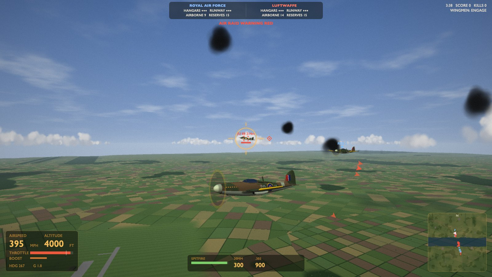
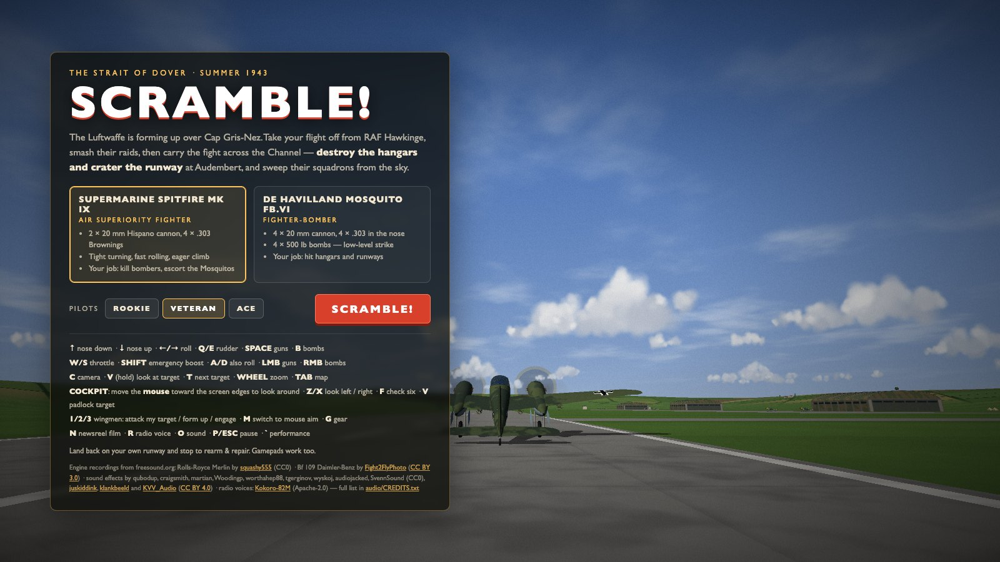
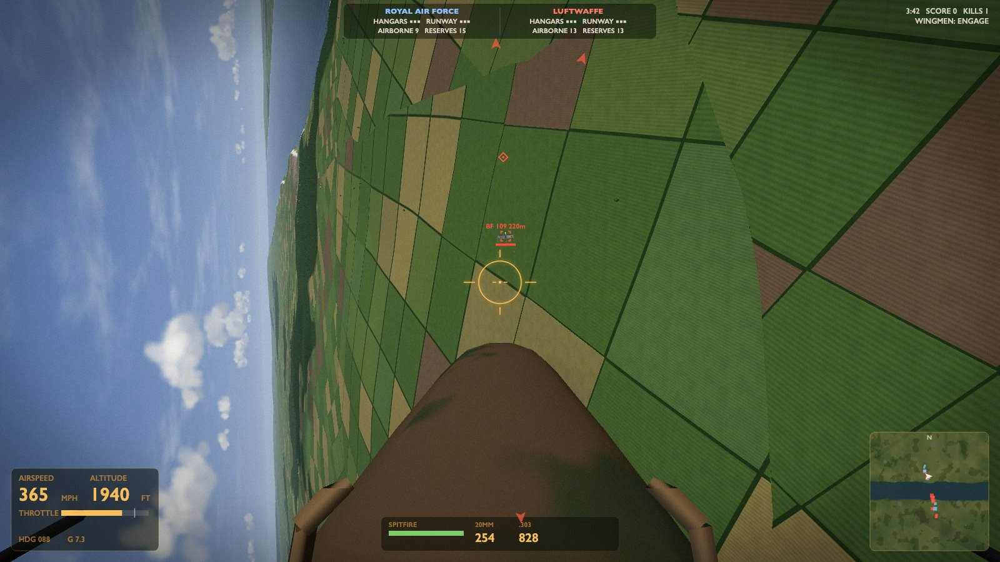
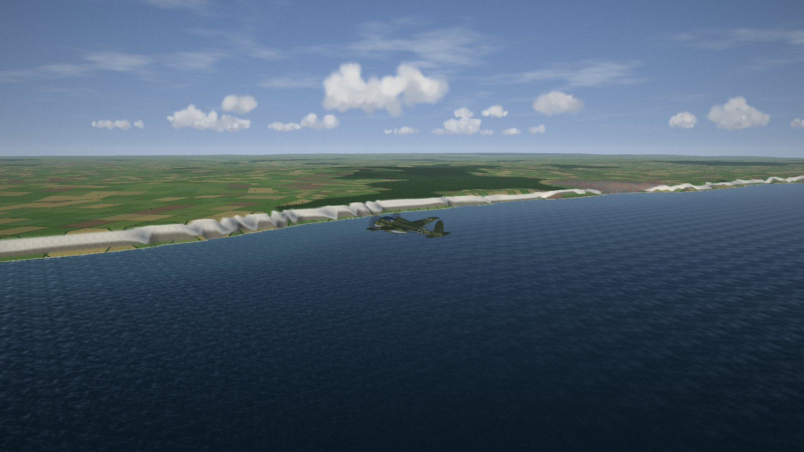
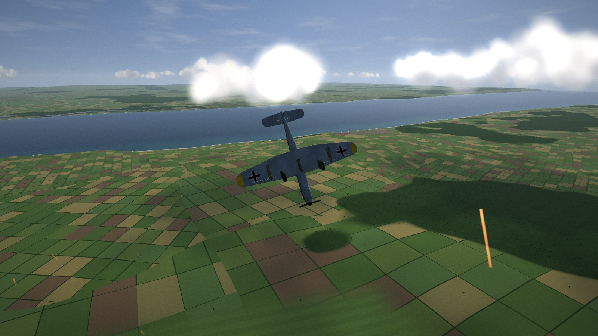
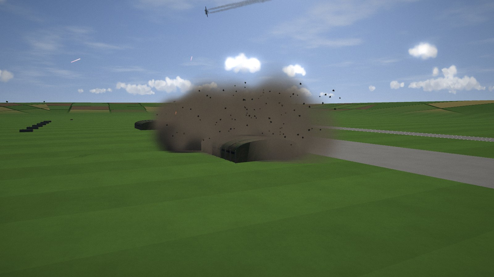
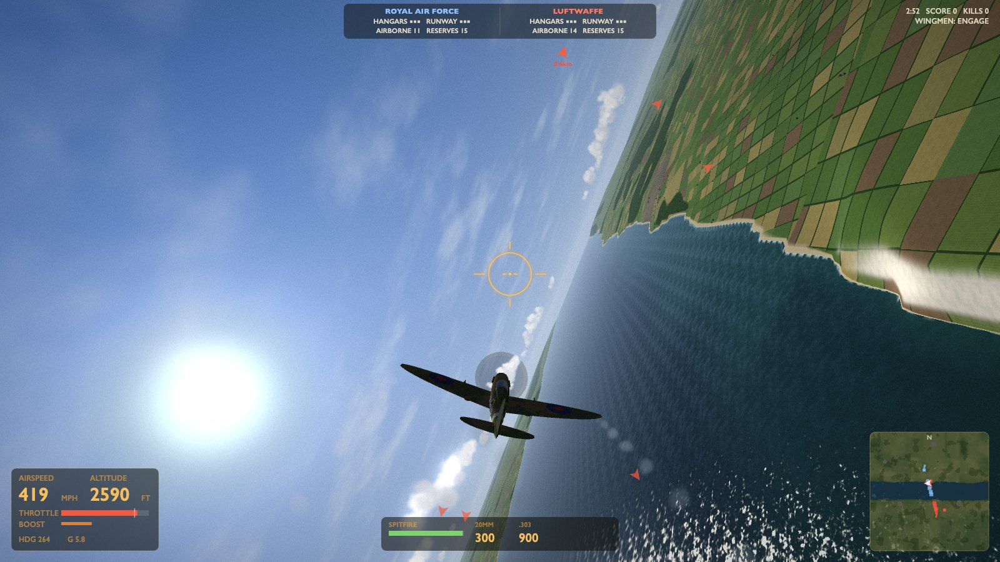
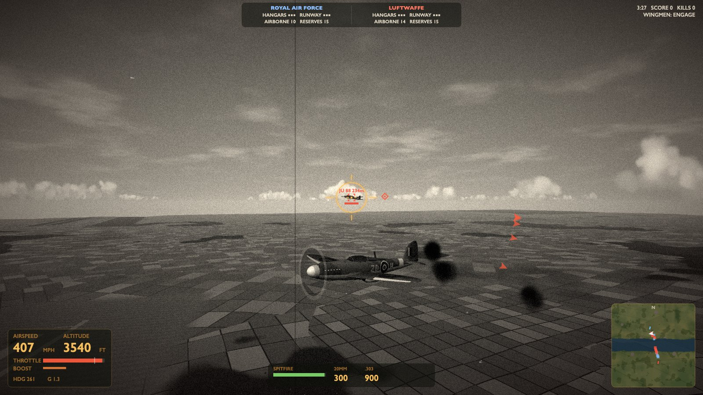

# SCRAMBLE! — Channel 1943

A WW2 arcade air-combat game in the browser: Spitfires and Mosquitos against Bf 109s, Fw 190s,
Ju 87 Stukas and Ju 88s over a compressed Strait of Dover. Two airfields, a 44 km battle area, and two AI
commanders who scramble fighters, send bomber raids with escorts and fight a war of attrition.
You decide it.

No build step, no dependencies: plain ES modules, raw WebGL2 and Web Audio. Every model and texture and
almost every sound is generated at start-up; the engines are real recordings (see Credits).



| | |
| --- | --- |
|  |  |
| Title screen, with the battle already running behind it | Cockpit: diving on a Bf 109, lead marker ahead of the reflector sight |
|  |  |
| A Ju 88 raid crossing the Channel below the White Cliffs | A Stuka rolls into its dive, 40 mm tracer coming up to meet it |
|  |  |
| Low-level Mosquito strike: a 500 lb bomb bursts on a hangar | Pulling hard over the chalk cliffs, wingtip vapour streaming |


*Press **N** for the newsreel film look.*

## Run

```sh
cd www2-dogfigher
python3 -m http.server 8000      # or: npx serve .
# open http://localhost:8000  (Chrome, Edge, Firefox or Safari)
```

Pick the **Spitfire** (cannon, air superiority) or the **Mosquito** (cannon + 4 × 500 lb bombs), a pilot
level, and press **SCRAMBLE!** You start on the runway at RAF Hawkinge with three wingmen; the Luftwaffe's
first raid is already forming over Cap Gris-Nez.

**Win:** destroy the three hangars at Audembert (they hold the enemy reserves), crater all three runway
sections (no more take-offs) and shoot down whatever is left in the air. **Lose:** the same happens to
Hawkinge. Shot down? Pick another aircraft from your reserves while your runway still works.

## Deploy (GitHub Pages)

`.github/workflows/pages.yml` publishes the game on every push to `master` (or run it by hand from the Actions
tab). It syntax-checks the modules, runs a short headless AI battle as a smoke test, then uploads only what
the game serves (`index.html`, `css/`, `js/`, `audio/`). One-time setup: repository **Settings → Pages →
Source: GitHub Actions**. All paths are relative, so the game works from the `https://<user>.github.io/<repo>/` subpath.

## Controls

| | |
| --- | --- |
| ↑ / ↓ | Stick forward = nose down / stick back = nose up (release to hold attitude) |
| ← / → (or A / D) | Roll · **Q / E** rudder |
| Space / LMB | Guns |
| B / RMB | Bombs (Mosquito: the yellow circle is the impact predictor) |
| W / S | Throttle · **Shift** emergency boost (watch the engine heat) |
| M | Switch to mouse-aim flying (point where you want to go; click to capture the mouse) and back |
| C | Camera: chase / cockpit / fly-by · **V** (hold) look at your target · wheel: zoom |
| Cockpit look | Move the mouse toward the screen edges to turn your head (sides = along the wings, far edge = over your shoulder, top = up); centre = straight ahead. **Z / X** look left / right, **F** check six, **V** padlock the target |
| T | Next target (the red diamond is the gun lead point) |
| 1 / 2 / 3 | Wingmen: attack my target / form up on me / engage at will |
| G | Gear and flaps (automatic by default: they come down together when you approach your own airfield low and slow, below about 2,000 ft over the runway) · land and stop to rearm and repair (hold **S** to brake; closing the throttle also brakes). The altimeter reads height above the ground, and a landing checklist appears on approach: gear, speed, sink rate, wings level |
| Tab | Big map · **N** newsreel film look · **R** radio voices on/off · **O** sound · **P / Esc** pause · **`** performance overlay |

### Gamepad (DualShock 4 / DualSense / Xbox)

Plug in or pair the controller and press any button; the title screen then lists the bindings for it. The
browser has to expose it with the standard mapping (Chrome, Edge, Safari and Firefox all do for these pads).

| PlayStation (Xbox) | |
| --- | --- |
| Left stick | Fly: pitch and roll (release to hold attitude) |
| L1 / R1 (LB / RB) | Rudder |
| R2 (RT) | Guns |
| L2 or ✕ (LT or A) | Bombs |
| D-pad ↑ / ↓ | Throttle · **L3** (left stick click) emergency boost |
| Right stick | Look around: head look in the cockpit, orbit the chase camera · **R3** check six |
| △ (Y), hold | Look at / padlock the target |
| □ (X) | Next target |
| ○ (B) | Camera |
| D-pad ← / → | Wingman orders: step through attack my target / form up / engage at will |
| Share (View) | Gear · **Touchpad** big map · **Options (Menu)** pause |
| Menus | D-pad or left stick to move, **✕ (A)** to choose, **○ (B)** to resume, **Options** to scramble |

The controller rumbles with your guns, hits taken, nearby explosions and flak, bomb release and the stall
buffet (Chrome, Edge and Safari). Most browsers do not count a pad press as a user gesture for Web Audio, so if you start
from the controller, the sound comes on with the first click or key press.

## What's going on under the hood

* **Arcade flight model** (`js/flight.js`): the stick commands body rates and a released stick holds
  attitude, on top of a point-mass with power-limited thrust, parasite and induced drag, AoA lift with a
  stall, and side force. Corner speed, energy bleed in hard turns, zoom climbs, stalls and the Stuka's
  dive brakes all fall out of the physics. Taildragger ground handling, tail-down attitude, auto gear with
  gear-linked landing flaps (lower stall speed, lots of drag), ground effect, and a landed aircraft that
  stays on its wheels until you open up and pull for a go-around.
* **AI** (`js/ai.js`): every AI aircraft is flown through the same stick inputs as yours by a bank-to-turn
  controller. Behaviours: take-off, formation (velocity matching), escort, CAP, intercept, gun lead pursuit
  with skill-based aim wobble, break turns when someone is on their tail, level bombing with an impact
  predictor, Stuka dive-bombing, strafing runs, return to base. A safety layer handles terrain and stalls.
  Bomber gunners, heavy flak with time-fused bursts, and 40 mm light AA defend the airfields.
* **Commanders** (`js/sim.js`): Chain Home radar gives the RAF earlier warning; each side scrambles
  interceptors, launches raids with escorts, tops up its CAP and, later in the battle, sends fighter sweeps
  to strafe the enemy field. Aircraft come out of hangar stock, so bombing hangars and strafing parked
  aircraft reduces the enemy's reserves.
* **Renderer** (`js/render.js`): camera-relative rendering + logarithmic depth (cockpit frame at 0.3 m and
  hills at 40 km in one pass), CDLOD terrain (one grid patch instanced over a quadtree, morphing between
  levels, heights fetched in the vertex shader), a procedural English/French patchwork of fields and hedges,
  chalk cliffs, animated sea with Fresnel reflections, cloud shadows matching the sprite clouds, instanced
  everything (~40 draw calls), planar aircraft shadows, MSAA, bloom, film grading and dynamic resolution.
  Houses and trees stream in 2 km chunks with frustum culling and a far-LOD tree mesh.
* **Audio** (`js/audio.js`): real engine recordings (a Spitfire's Rolls-Royce Merlin on a static run and a
  Bf 109's Daimler-Benz run-up, cut into seamless idle / full-power loops in `audio/`) crossfaded with rpm,
  Doppler-shifted for fly-bys; synthesized engines as a fallback;
  20 mm / .303 / 13 mm guns, explosions delayed by the speed of sound, flak, the Stuka's Jericho trumpet and
  the air-raid siren.
* Simulation runs at a fixed 60 Hz; aircraft are drawn at frame time (advanced by the leftover sub-step), so
  nothing judders against the camera on 120/144 Hz displays.

## Tools

```sh
node tools/battle.mjs normal 30 4   # headless AI-vs-AI battles: outcome, losses, kill matrix, sim speed
node tools/fmtest.mjs               # flight model: top speed, climb, turn, take-off run per type
node tools/landtest.mjs             # landing: scripted idle approaches to Hawkinge must all end stopped on the wheels
```
`tools/modelview.html` previews every procedural model; `tools/audiotest.html` plays every sound.
`node tools/make-engine-loops.mjs` rebuilds the engine loops in `audio/` from the original recordings (needs ffmpeg).
`cd tools/voices && npm i && node make-voices.mjs` regenerates the radio voice lines in `audio/voice/` with the
Kokoro TTS model (runs locally, ~6 min on a laptop CPU; `--force` to redo all, or name keys to redo some). Edit the
lines, or swap the voices (`SPEAKERS`: George for Sector Control, Lewis for the wingmen, Fable for the ground crew,
Daniel for you) in `js/voicelines.js`.

## Credits

Radio voices: generated with [Kokoro-82M](https://huggingface.co/hexgrad/Kokoro-82M) (Apache-2.0) via
[kokoro-js](https://www.npmjs.com/package/kokoro-js), British English voices bm_george, bm_lewis, bm_fable, bm_daniel.

Engine recordings from [freesound.org](https://freesound.org), cut into loops by `tools/make-engine-loops.mjs`:

* ["merlin engine.wav"](https://freesound.org/people/squashy555/sounds/276597/) by squashy555, Rolls-Royce Merlin from a Spitfire on a static engine run, [CC0](https://creativecommons.org/publicdomain/zero/1.0/)
* ["Bf-109 - Daimler-Benz Run-Up"](https://freesound.org/people/Fight2FlyPhoto/sounds/142898/) by Fight2FlyPhoto, [CC BY 3.0](https://creativecommons.org/licenses/by/3.0/) (also used, pitched down, for the Fw 190)

Sound effects from [freesound.org](https://freesound.org), cut, filtered, compressed and normalised by `tools/make-sfx.mjs` into `audio/sfx/` (full list with the files each one is used for in `audio/CREDITS.txt`):

* ["Autocannon Three Shot Burst"](https://freesound.org/people/qubodup/sounds/854186/) by qubodup, [CC0](https://creativecommons.org/publicdomain/zero/1.0/): 20 mm cannon shots
* ["Air Defense Artillery Avenger Training .50cal"](https://freesound.org/people/qubodup/sounds/160355/) by qubodup, [CC0](https://creativecommons.org/publicdomain/zero/1.0/): 13 mm / .50 heavy machine-gun shots (US Army video, public domain)
* ["Clean Machine Gun Burst"](https://freesound.org/people/qubodup/sounds/482122/) by qubodup, [CC0](https://creativecommons.org/publicdomain/zero/1.0/): rifle-calibre machine-gun shots (US military video, public domain)
* ["Nearby explosion with debris.wav"](https://freesound.org/people/juskiddink/sounds/108641/) by juskiddink, [CC BY 4.0](https://creativecommons.org/licenses/by/4.0/): close explosion
* ["Explosion"](https://freesound.org/people/qubodup/sounds/182429/) by qubodup, [CC0](https://creativecommons.org/publicdomain/zero/1.0/): close explosion (US government video, public domain)
* ["mortar  grenade shell 006.wav"](https://freesound.org/people/klankbeeld/sounds/554289/) by klankbeeld, [CC BY 4.0](https://creativecommons.org/licenses/by/4.0/): close explosion, flak burst
* ["Explosion"](https://freesound.org/people/tgerginov/sounds/665092/) by tgerginov, [CC0](https://creativecommons.org/publicdomain/zero/1.0/): bomb explosion
* ["Heavy explosion in forest debris tree falling.flac"](https://freesound.org/people/wyskoj/sounds/530163/) by wyskoj, [CC0](https://creativecommons.org/publicdomain/zero/1.0/): bomb explosion
* ["Distant explosion.wav"](https://freesound.org/people/juskiddink/sounds/108640/) by juskiddink, [CC BY 4.0](https://creativecommons.org/licenses/by/4.0/): distant explosion
* ["Quarry blasting.wav"](https://freesound.org/people/juskiddink/sounds/82682/) by juskiddink, [CC BY 4.0](https://creativecommons.org/licenses/by/4.0/): distant explosions
* ["EXPLReal_Air Explosion Medium Distance_KVV AUDIO_FREE"](https://freesound.org/people/KVV_Audio/sounds/871382/) by KVV_Audio, [CC BY 4.0](https://creativecommons.org/licenses/by/4.0/): flak burst
* ["mortar bomb fireworks New Year Netherlands 918 pm 251231_0059"](https://freesound.org/people/klankbeeld/sounds/840902/) by klankbeeld, [CC BY 4.0](https://creativecommons.org/licenses/by/4.0/): flak burst
* ["Foley bullet hit metal 02.wav"](https://freesound.org/people/martian/sounds/182263/) by martian, [CC0](https://creativecommons.org/publicdomain/zero/1.0/): bullet hits on aircraft
* ["bullets hit EDIT.aif"](https://freesound.org/people/Woodingp/sounds/116645/) by Woodingp, [CC0](https://creativecommons.org/publicdomain/zero/1.0/): hits on the player's aircraft
* ["S20-47 50 cal Browning machine gun bullet impacts.wav"](https://freesound.org/people/craigsmith/sounds/675944/) by craigsmith, [CC0](https://creativecommons.org/publicdomain/zero/1.0/): bullet impacts on the ground
* ["Single Rock hit dirt 2.wav"](https://freesound.org/people/worthahep88/sounds/319229/) by worthahep88, [CC0](https://creativecommons.org/publicdomain/zero/1.0/): bullet impact on the ground
* ["S31-17 Bullets hitting water.wav"](https://freesound.org/people/craigsmith/sounds/675947/) by craigsmith, [CC0](https://creativecommons.org/publicdomain/zero/1.0/): bullet impacts on water
* ["Alarm, Air Raid Siren, Test, Devonport, Sony PCM M-10.wav"](https://freesound.org/people/audiojacked/sounds/336640/) by audiojacked, [CC0](https://creativecommons.org/publicdomain/zero/1.0/): air-raid siren (looped)
* ["Whizzbang Drop.mp3"](https://freesound.org/people/SvennSound/sounds/434739/) by SvennSound, [CC0](https://creativecommons.org/publicdomain/zero/1.0/): falling-bomb whistle (flattened to a constant pitch and looped)

The Ju 87 dive siren, UI sounds, radio squelch and wind are still synthesized; every recording falls back to its synthesized version if it can't be loaded.

## Files

```
js/main.js       game loop, cameras, player controls, effects/audio glue, menus
js/sim.js        battle simulation, weapons, damage, airfields, AA, commanders, victory
js/ai.js         AI pilots and the shared steering controller
js/flight.js     arcade flight model;  js/types.js aircraft and weapon data
js/world.js      the map: heights, coastlines, cliffs, towns, forests, airfields, targets
js/render.js     WebGL2 renderer;  js/particles.js particle system and effects
js/models.js     procedural aircraft, buildings and props;  js/mesh.js mesh builder
js/hud.js        gunsight, markers, instruments, minimap, radio;  js/input.js keyboard/mouse/gamepad
js/audio.js      audio engine: recorded engines + sound effects (audio/), synthesized fallbacks
```
